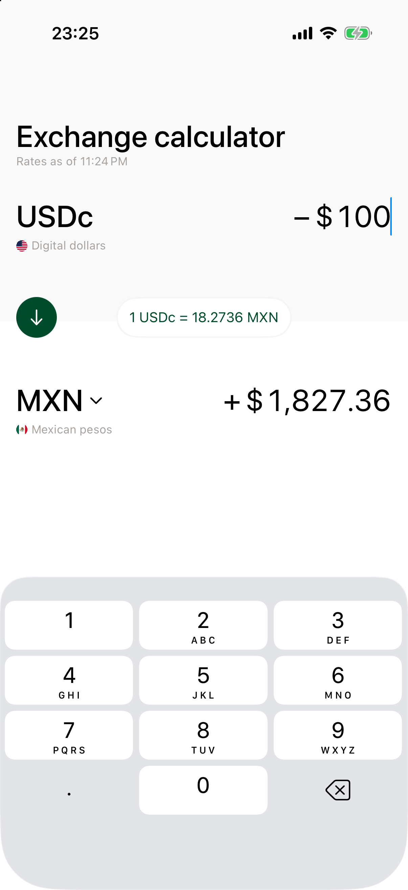
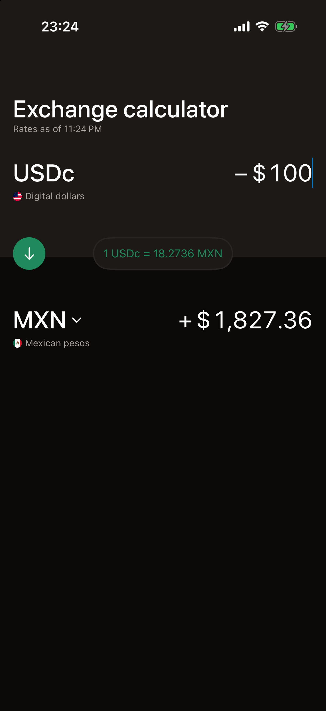
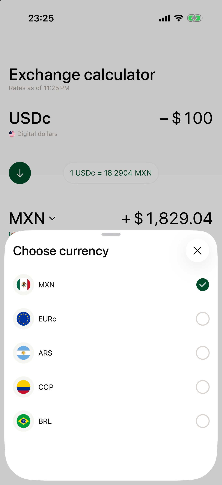
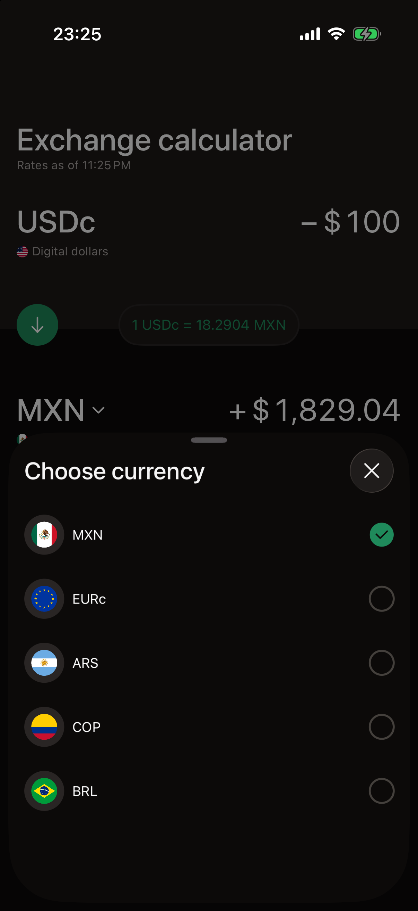

# CurrencyConverter

A USDc ⇄ other-currency exchange calculator for the DolarApp iOS take-home: SwiftUI, iOS 17+, iPhone only, Swift 6.

| | Light | Dark |
|---|---|---|
| Converter |  |  |
| Currency picker |  |  |

## Running

Requires Xcode 26 or later. Open `CurrencyConverter.xcodeproj`, pick the shared `CurrencyConverter` scheme and an iPhone simulator, and run. There are no third-party dependencies. The two local packages resolve automatically, and the SwiftLint build phase is skipped when SwiftLint isn't installed.

The deployment target is iOS 17. The app was tested on iOS 26 and later, on an iPhone 17 Pro and an iPhone SE (2nd generation).

## Features

- **Two amount fields.** Edit either one and the other recalculates. Tapping anywhere on a row focuses its amount field.
- **Currency picker.** Tapping the non-USDc currency opens the "Choose currency" sheet with MXN, EURc, ARS, COP and BRL.
- **Swap.** The arrow button moves USDc between the top and bottom rows. The last edited amount stays and the other one is recalculated for the new direction. A focused field keeps focus on its currency in the new row.
- **Direction-aware rate.** With USDc on top you sell USDc, so the app uses the `bid`. With USDc on the bottom you buy USDc, so it uses the `ask`. The `-` and `+` signs on the rows match the Figma.
- **Updates every 30 seconds.** "Rates as of" always shows when the rates on screen were fetched.
- **Loading skeleton** while the first rates load.
- **Offline screen with Retry.** Shown when the first load fails and the device has no internet connection.
- **Error screen with Retry.** Shown when the first load fails while the device is online, for example because of a backend error.
- **Light and Dark Mode.** Figma only has light frames, so the dark palette is self-designed.
- **Dynamic Type.** Every text style scales with the system text size. A long amount shrinks to fit its row, and the rate pill stops growing at `xxLarge` so it stays on one line.
- **Spanish localization.** English and Spanish through a String Catalog. Numbers and times follow the user's locale.
- **Design system** and a **lightweight network layer** as local Swift packages (see below).
- **Currency list without the currencies endpoint.** `/v1/tickers-currencies` returns HTTP 403, and the brief requires the app to work without it, so the list is bundled.

## Architecture

Clean Architecture with MVVM and a Coordinator, organized by feature. Dependencies point inward: Domain depends on nothing, and Data and Presentation both depend on Domain.

```
CurrencyConverter/
  App/                    CurrencyConverterApp, RootView, AppCoordinator (sheet routing), DependencyContainer
  Features/Converter/
    Domain/               Currency, ExchangeRate, ExchangeRatesSnapshot, repository protocols, use cases
    Data/                 TickerDTO, TickersAPIClient, RemoteExchangeRateRepository, FallbackCurrencyCatalogRepository
    Presentation/         ConverterScreen, ConverterViewModel, AmountFormatter, CurrencyDisplayInfo,
                          Components/ (converter UI), CurrencyPicker/ (the sheet)
  Shared/                 NetworkMonitor port, NWPathNetworkMonitor, StatusScreenView
  Resources/              Localizable.xcstrings, Localized.swift
Packages/
  DesignSystem/           Tokens, icons, skeleton and shrink-to-fit modifiers
  Networking/             RequestBuilder, NetworkClient, NetworkError
```

- `ConverterViewModel` (`@Observable`) owns screen state: `.loading`, `.converter(Content)` or `.failed(LoadError)`. It only parses and formats. `ConvertCurrencyUseCase` picks the bid or ask and does the math.
- `DependencyContainer` is the only place that wires Data types to Domain protocols. `AppCoordinator` owns sheet routing, and `CurrencyPickerView` only reports `onSelect` and `onClose`.
- The project uses Swift 6 strict concurrency. The app target defaults to `MainActor` isolation, and Domain and Data types opt out with `nonisolated`.
- Errors are typed at every layer: `throws(NetworkError)` → `throws(ExchangeRatesError)` → the view model's `throws(LoadError)`. DTOs and `NetworkError` never reach Domain.
- Domain holds no display strings. "EURC" → "EURc", subtitles and flags live in Presentation (`CurrencyDisplayInfo`).

### Design System

`Packages/DesignSystem` holds the tokens, named after the Figma variables:

- `DS.Color`: each token is a plain `Color` with a light and a dark hex that follows the system appearance.
- `TextStyle`, applied with `.textStyle(.h3)`: scales with Dynamic Type through `@ScaledMetric`, relative to a system text style.
- `DS.Spacing`, `DS.Radius`, `DS.Size` and `DS.BorderWidth`, the icons in `DS.Icon`, the `.skeleton(_:)` loading modifier, and `.shrinkToFit(minimumScale:)`, which scales a long amount down to fit its row.

Views never use raw colors or `.system(size:)`.

### Network layer

`Packages/Networking` is small and app-agnostic:

- `RequestBuilder` is a fluent value type that produces a `URLRequest`.
- `NetworkClient` / `URLSessionNetworkClient` sends it and decodes the response. Only HTTP 200 counts as success.
- Everything throws a typed `NetworkError` that wraps transport and decoding failures. A non-200 response keeps its `HTTPURLResponse`, so the `x-correlation-id` header stays readable.

## Implementation notes

### Money

Amounts and rates are `Decimal` from the API response to the screen, and the conversion keeps full precision. Values are rounded only for display, half-up: amounts to 2 decimals in every currency, including COP (the Figma shows COP without decimals), and the rate to 4. For example, 0.125 shows as 0.13.

### API quirks handled

- An unknown or lowercase code, or a space in the `currencies` list, makes the whole batch fail with HTTP 500. Codes come from the bundled list and are joined with `,` and no spaces.
- An unsupported code such as `EUR` comes back as a `null` array element. The response decodes as `[TickerDTO?]` and nulls are dropped.
- Tickers are matched to currencies by their `book` (`usdc_mxn`), never by array index, because dropping nulls shifts the indices.
- `ask` and `bid` arrive as strings with 10 decimals and are parsed straight into `Decimal`.

### Loading, offline and errors

The first load fetches the currency list, then the rates for those codes. If either fails, the view model asks `NWPathMonitor` whether the device is online. Offline shows "No connection" and online shows "Something went wrong", each with a Retry button. In both cases the amount fields are left out of the view hierarchy. The 30-second loop also retries both screens. Once rates have loaded, a failed refresh keeps them on screen.

## Testing

Unit tests use Swift Testing and mirror the app's folder layout:

- **Domain:** `ConvertCurrencyUseCase`, `LoadExchangeRatesUseCase`, `CurrencyCatalogUseCase`.
- **Data:** `TickerDTO` decoding, `DefaultTickersAPIClient`, `RemoteExchangeRateRepository`.
- **Presentation:** `ConverterViewModel`, `AmountFormatter`, `CurrencyDisplayInfo`.
- **Packages:** `RequestBuilder`, `URLSessionNetworkClient`, DesignSystem colors.

Coverage:

| Area | Lines covered |
|---|---|
| Converter Domain and Data | 100% |
| `ConverterViewModel` | 94% |
| `AmountFormatter` | 99% |
| Networking package | 96% |
| App target overall | 69% |

The app target's overall number is lower because the SwiftUI views and their previews aren't unit-tested.

## Code quality tooling

- **SwiftLint** (`.swiftlint.yml`) runs as a build phase over the app, the tests and the packages. Force unwraps are banned with no exceptions.
- **SwiftFormat** (`.swiftformat`) enforces formatting and one declaration order in every type.
- **Pre-commit hook** (`.githooks/pre-commit`) formats staged Swift files, then runs `swiftlint lint --strict`, so any warning blocks the commit. Enable it with `git config core.hooksPath .githooks`.
- **Periphery** (`.periphery.yml`) finds unused code with `periphery scan`.

## Trade-offs

- **Rates aren't cached.** A currency converter has to show up-to-date rates, so a cold start without a connection shows the "No connection" screen instead of rates saved earlier. If a refresh fails after rates have loaded, they stay on screen and "Rates as of" shows when they were fetched. There's no separate stale marker. A production app could cache the last rates for display only, labeled with when they were fetched.
- **Retry instead of auto-reconnect.** To keep the logic simple, the app doesn't retry when the connection comes back. Recovery comes from the Retry button or the 30-second loop.
- **Rates refresh on a fixed 30-second loop.** The next request goes out 30 seconds after the previous response arrives, whether it succeeded or failed. The API's per-quote timestamp is ignored, so refreshes aren't aligned with when the server issued its quotes, and "Rates as of" uses the device clock.
- **Connectivity explains a failure; it never blocks a request.** The app always sends the request and asks `NWPathMonitor` only after the first load fails. A usable network path doesn't prove the API is reachable (behind a captive portal, for example), so that case shows the error screen and the loop keeps retrying.
- **The tickers response format is trusted.** The app handles the quirks above but doesn't validate prices or `book` beyond that. A production client would reject non-positive prices and never let a response with no usable rates replace the ones on screen.
- **The system decimal pad replaces the Figma keypad.** Amount entry is a plain `TextField` with `.keyboardType(.decimalPad)`. The written brief doesn't require a custom keypad, and the Figma one has the same layout as the system number pad.
- **System font.** The brief allows it instead of the custom font in the designs, and it works with Dynamic Type for free.
- **Self-designed states.** Figma has no loading, error, offline or dark frames, so the skeleton, the two status screens and the dark palette are my own design.
- **The currency list is hardcoded.** `/v1/tickers-currencies` returns HTTP 403, so the five currencies come from a bundled list behind `CurrencyCatalogRepository`. If the endpoint worked and returned names and flag images too, the plan is:
  - Already in place: the converter loads the list first, then the rates for those codes, since the tickers request needs them, and hands the loaded list to the picker, so it opens instantly. With a live endpoint, only the repository changes. This is also why the picker is part of the Converter feature.
  - Flag images are prefetched as soon as the list arrives and cached in memory, with a grey placeholder until each one loads.
  - If the list request fails, the bundled list is used instead: today's `FallbackCurrencyCatalogRepository`.
  - Codes are checked before they're joined into the tickers request, because one unexpected code makes the whole batch fail with HTTP 500. If it still fails, the selected currency is fetched on its own.

## Out of scope

- Logging
- Analytics
- VoiceOver support
- More languages (for example Portuguese for BRL)
- iPad and landscape
- UI and snapshot tests
