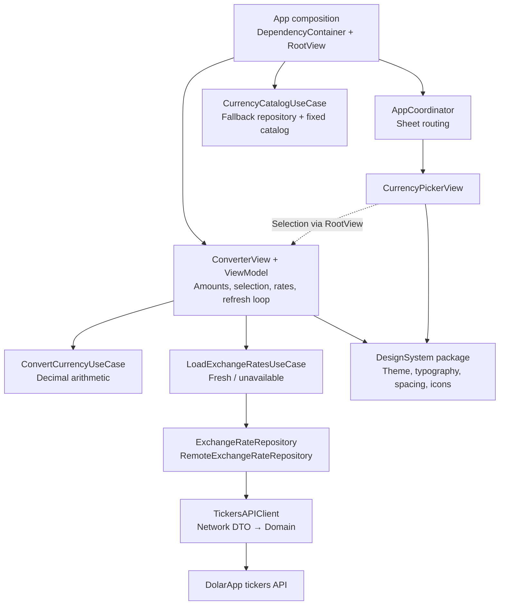

# CurrencyConverter architecture review

Reviewed against `main` at `d5e1b3e`. The checkout advanced during the review; this document includes the merged refresh implementation. Application code was not changed. Rates are no longer persisted (#13), so local storage is left out. Code links point to the reviewed commit; the Status column records what happened to each proposal since.

**Recommendation:** keep the feature-oriented Clean Architecture + MVVM structure. The most useful work is to strengthen data validation, make amount edits atomic, and complete screen-state handling. The existing app composition, repository seams, and DesignSystem package are appropriate for this project's size.

**Current high-level diagram**

Solid arrows show runtime use or ownership; the dashed arrow shows a selection callback. Repository implementations are injected through Domain protocols, so runtime calls into Data do not mean Domain imports Data.

`Shared/Domain` supplies currency identity; `Shared/Presentation` supplies display labels, symbols, and flags. These support both features and are omitted from the diagram to keep it readable. Converter and CurrencyPicker are folders within the app target; DesignSystem is a separate Swift package.

The converter refreshes on appearance, periodically according to the oldest server quote time, and when returning to the foreground if rates are due. Concurrent callers share an in-flight load. A failed fetch leaves the rates already on screen in place, marked stale. Amount conversion is local and does not request new rates for each edit or selection.

**What is already working well**

- Dependencies are assembled in one composition root; the picker reports actions through callbacks and has no navigation ownership.
- Money uses `Decimal`; input parsing and display formatting are separate from arithmetic. Bid/ask follows row position, and the model preserves the last edited amount as the conversion source.
- Network DTOs are separate from Domain entities.
- Unit tests cover arithmetic, formatting, selection/swap behavior, failed refreshes, request sharing, and refresh timing. DesignSystem has its own tests.

**Prioritized proposals**

Scores use `(impact + risk) × (6 − effort)`, with each dimension rated 1–5. Estimates are rough implementation-and-test effort, not delivery commitments. Behavioral risks take precedence over cosmetic cleanup.

| Order | Proposal | Kind | Impact / risk / effort | Score | Estimate | Status |
|---|---|---|---|---:|---|---|
| 1 | Validate rates before use | Correctness + refactor | 5 / 5 / 2 | 40 | 0.5–1 day | Dropped: the tickers format is trusted (README) |
| 2 | Sanitize edits before changing conversion state | Correctness + refactor | 4 / 5 / 2 | 36 | 0.5 day | Done in #11 |
| 3 | Model initial loading, content, and unavailable screens | Unfinished requirement | 5 / 4 / 2 | 36 | 0.5–1 day | Open |
| 4 | Add fixture composition and boundary/UI regressions | Testability refactor | 4 / 4 / 3 | 24 | 1–2 days | Open |
| 5 | Reconcile project guidance and verification commands | Documentation | 2 / 2 / 1 | 20 | 0.25 day | Open; README started in #13 |
| 6 | Consolidate refresh deadline rules | Small structural refactor | 3 / 3 / 3 | 18 | 0.5 day | Superseded: plain 30 s loop |

**1. Validate rates before use.**

*Status: dropped. The app trusts the tickers response format and handles only the documented quirks; the README's "Deliberate simplifications" section records this and what a production client would add. The attempt is in the closed #12.*

[TickerDTO.swift:18](https://github.com/ArturSakhno/CurrencyConverter/blob/d5e1b3ee75d25c6e65e363c1393b0500df2529a0/CurrencyConverter/Features/Converter/Data/Network/TickerDTO.swift#L18) accepts nonpositive prices and treats the final `book` segment as a valid quote currency. Both `btc_mxn` and `mxn` are accepted as MXN quotes despite not identifying the expected base/quote pair.

[TickersAPIClient.swift:41](https://github.com/ArturSakhno/CurrencyConverter/blob/d5e1b3ee75d25c6e65e363c1393b0500df2529a0/CurrencyConverter/Features/Converter/Data/Network/TickersAPIClient.swift#L41) can produce an empty collection from a null-only response, which the use case reports as fresh and which replaces the rates on screen. The model's unavailable fallback does not protect against an empty successful result.

Introduce shared Domain validity rules for positive prices and usable snapshots, applied by the ticker mapper. Validate the complete wire pair using configured catalog identity and requested quote codes. Reject unusable results before they replace the rates on screen. Define a deliberate partial-response policy: preserve useful entries while representing missing currencies explicitly, or reject an incomplete requested set. Keep null tolerance and content-based matching.

Acceptance checks: wrong-base/malformed pairs, zero/negative prices, duplicate or unrequested quotes, and null-only responses; an unusable response must keep the last valid rates on screen. Decide and test the partial-result behavior explicitly.

**2. Sanitize edits before changing conversion state.**

*Status: done in #11.*

[ConverterViewModel.swift:122](https://github.com/ArturSakhno/CurrencyConverter/blob/d5e1b3ee75d25c6e65e363c1393b0500df2529a0/CurrencyConverter/Features/Converter/Presentation/ConverterViewModel.swift#L122) stores raw text, changes `lastEditedField`, and recalculates. Only afterward does [AmountTextField.swift:101](https://github.com/ArturSakhno/CurrencyConverter/blob/d5e1b3ee75d25c6e65e363c1393b0500df2529a0/CurrencyConverter/Features/Converter/Presentation/Components/AmountTextField.swift#L101) sanitize the edit and write back. A rejected edit on the derived field can therefore make its rounded amount the new source of truth.

Move `sanitizeEdit(from:to:)` into the model's user-edit command. Compare the normalized result with the previous value before changing `lastEditedField`, then update and recalculate once. Use the same locale for input and model formatting. Keep focus and width measurement in the view, and preserve derived amounts that legitimately exceed the entry limit.

Acceptance checks: rejected edits leave both amounts and source ownership unchanged; grouping and decimal separators still work; oversized derived values remain intact; swap/currency changes preserve the accepted source amount.

**3. Model initial loading, content, and unavailable screens.**

*Status: open. The No connection screen is still to be built.*

[ConverterView.swift:50](https://github.com/ArturSakhno/CurrencyConverter/blob/d5e1b3ee75d25c6e65e363c1393b0500df2529a0/CurrencyConverter/Features/Converter/Presentation/ConverterView.swift#L50) always renders the amount fields. The initial model state is `.unavailable`, so it cannot distinguish an initial request from a completed failure. The required blocking No connection screen and Retry action are absent.

Add a small Presentation state such as `initialLoading`, `content`, and `unavailable`, with refresh/freshness metadata attached to content. Leave the existing Domain load result intact. Render the amount fields only in the content branch; retain content during refreshes and when a refresh fails. Attach loading/refresh tasks to a stable screen container so switching content branches does not unintentionally restart the loop.

Acceptance checks: first-launch offline has no amount fields in the accessibility hierarchy; Retry can reach content; a failed refresh keeps the amounts on screen. This is completion of an existing requirement.

**4. Add fixture composition and boundary/UI regressions.**

*Status: open. The template UI test target has since been removed, so UI regressions would need a new target.*

[DependencyContainer.swift:6](https://github.com/ArturSakhno/CurrencyConverter/blob/d5e1b3ee75d25c6e65e363c1393b0500df2529a0/CurrencyConverter/App/DependencyContainer.swift#L6) always constructs the live network dependency; the converter preview uses the same factory. Add a small dependency initializer or fixture factory for previews and deterministic UI-test scenarios.

[CurrencyConverterUITests.swift:19](https://github.com/ArturSakhno/CurrencyConverter/blob/d5e1b3ee75d25c6e65e363c1393b0500df2529a0/CurrencyConverterUITests/CurrencyConverterUITests.swift#L19) launches the app without asserting behavior. Replace that template with conversion/edit rejection, swap focus, picker selection, and first-launch offline/Retry checks. Test the real API client using its injectable `URLSession`: URL query construction, HTTP status/correlation ID mapping, invalid JSON, and cancellation. Existing DTO tests do not exercise this client path.

Replace the 20 ms sleep used by the overlapping-load test with a manually released async gate. Repository tests already exist; extend them for rejected responses rather than rebuilding their test seams.

**5. Reconcile project guidance and verification commands.**

*Status: open. The README was started in #13.*

Add a short README with architecture, build/test commands, decisions, and minimum toolchain. [Package.swift:1](https://github.com/ArturSakhno/CurrencyConverter/blob/d5e1b3ee75d25c6e65e363c1393b0500df2529a0/Packages/DesignSystem/Package.swift#L1) requires Swift 6.3, which is distinct from the app's Swift 6 language mode.

[AGENTS.md](https://github.com/ArturSakhno/CurrencyConverter/blob/d5e1b3ee75d25c6e65e363c1393b0500df2529a0/AGENTS.md) and [CLAUDE.md](https://github.com/ArturSakhno/CurrencyConverter/blob/d5e1b3ee75d25c6e65e363c1393b0500df2529a0/CLAUDE.md) still claim the scheme is unshared and refer to an old design-token path and hand-written theme environment key. The shared scheme, package path, and `@Entry` implementation already exist. Clarify that Swift Testing is for unit tests and XCTest is used for UI automation. Keep important project decisions in the repository rather than only in a home-directory roadmap.

The app scheme does not include DesignSystemTests, and the lint configuration omits package sources. Provide one documented verification entry point covering the app and package; include package sources in lint scope. A new CI framework is optional for this take-home.

**6. Consolidate refresh deadline rules.**

*Status: superseded. The deadline logic was removed: rates now refresh 30 s after each response, and the API's quote time is ignored.*

[ConverterViewModel.swift:72](https://github.com/ArturSakhno/CurrencyConverter/blob/d5e1b3ee75d25c6e65e363c1393b0500df2529a0/CurrencyConverter/Features/Converter/Presentation/ConverterViewModel.swift#L72) and [line 96](https://github.com/ArturSakhno/CurrencyConverter/blob/d5e1b3ee75d25c6e65e363c1393b0500df2529a0/CurrencyConverter/Features/Converter/Presentation/ConverterViewModel.swift#L96) separately calculate when a snapshot is due. Extract a small pure `RatesRefreshPolicy` for deadline, clamping, and foreground eligibility; keep observable state and orchestration in the model.

Document cancellation ownership: cancelling the screen's refresh loop currently allows its shared request to finish. This is an ownership choice, not a demonstrated failure. Add a lifecycle test before changing it. Preserve the existing 30-second policy, injected clock/sleep, and in-flight request sharing.

**Suggested sequence**

1. Protect data and editing correctness with focused regressions, then implement proposals 1 and 2.
2. Add fixture composition and finish the unavailable/Retry flow, with screen-level assertions.
3. Complete HTTP boundary coverage and align documentation/verification. Consolidate refresh policy when touching that code next.

Keep the fixed currency catalog, lightweight coordinator, feature folders, existing Domain protocols, and DesignSystem package. Additional feature packages, a generic networking framework, or a state-management framework have no demonstrated payoff in this review. Minor cleanup such as moving `AmountField` out of the component file or sharing top/bottom row construction can follow behavioral work.

**Verification and limits**

The review inspected current source, tests, project settings, and branch history. A focused Swift executable compiled the current rate DTO and Domain entities and confirmed acceptance of wrong-base/malformed books and zero/negative prices. No live API request, full Xcode build, simulator run, or app/package test-suite execution was performed. Findings about view behavior are based on source flow and should be verified by the proposed regression tests.
